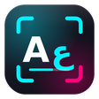
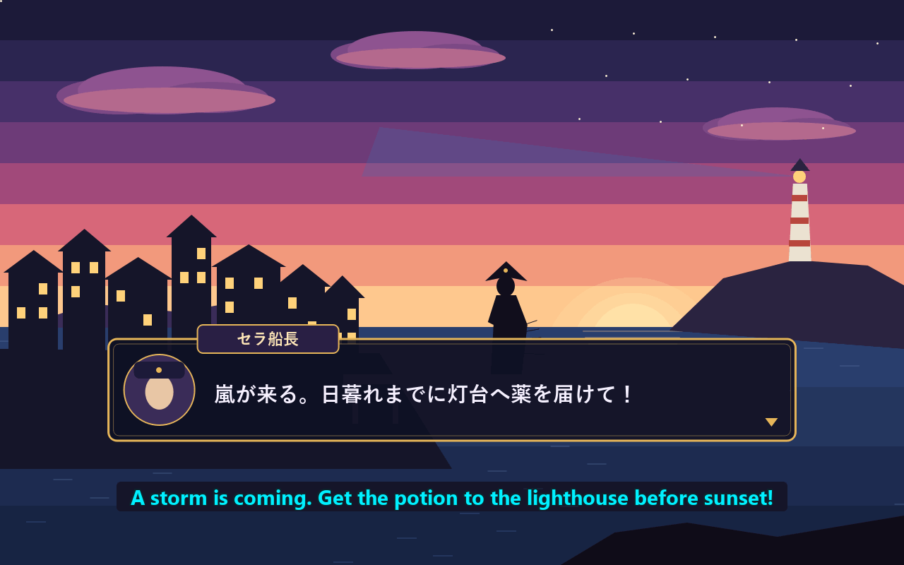
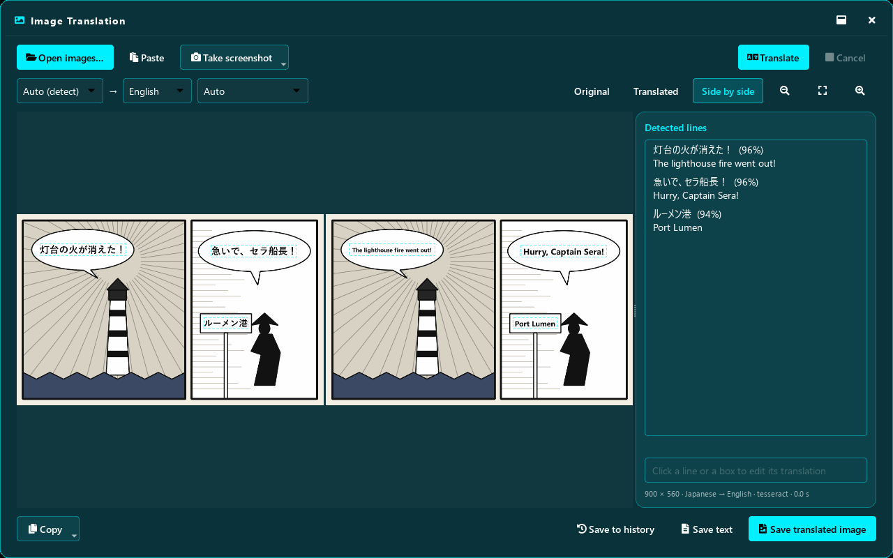
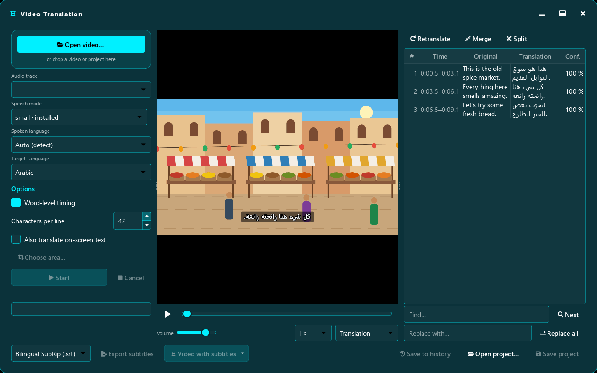
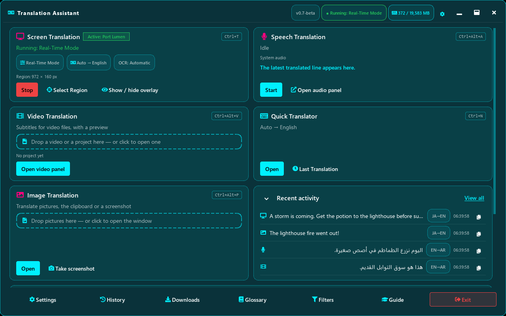

<p align="center">
  
</p>

<h1 align="center">Translation Assistant</h1>

<p align="center"><b>Translate games, pictures, speech and videos on your own Windows PC. No internet needed once it's set up.</b></p>

<p align="center">
  <a href="https://github.com/bkdev2320-dot/aiot-releases/releases/latest/download/AIOT-Setup.exe"><b>⬇ Download for Windows (AIOT-Setup.exe)</b></a>
  &nbsp;·&nbsp; <a href="https://aiot.youware.app">Website</a>
  &nbsp;·&nbsp; <a href="#العربية">العربية</a>
</p>

AIOT is the suite; Translation Assistant is its first app.

| Translate a game on your screen | Translate a picture or manga page |
|---|---|
|  |  |
| **Subtitles for any video** | **Everything in one place** |
|  |  |

## What it does

- **Translates what's on your screen.** Pick a part of the screen, such as a game's dialogue box, and the translation appears on top as you play.
- **Translates pictures.** Drop in a screenshot, a photo or a manga page, and the text is replaced with the translation.
- **Translates speech.** Live subtitles for what your PC is playing, or for your microphone.
- **Makes subtitles for videos.** It writes subtitles from a video's speech, translates them, and saves them as a subtitle file or burns them into the video.
- **Quick Translator** for typing or pasting text.
- **Works offline and stays private.** Everything happens on your PC; what you translate is never uploaded.
- **The app speaks 8 languages:** Arabic, Chinese, English, French, German, Russian, Spanish and Turkish. You can add more language packs.

## Download

| Which one? | File |
|---|---|
| **Most people** | **[AIOT-Setup.exe](https://github.com/bkdev2320-dot/aiot-releases/releases/latest/download/AIOT-Setup.exe)**: small and quick. It downloads only the languages you choose. |
| A PC **without internet** | **[AIOT-Setup-Offline.exe](https://github.com/bkdev2320-dot/aiot-releases/releases/latest/download/AIOT-Setup-Offline.exe)**: larger, with English ⇄ Arabic and the tools already inside. |

All versions: **[Releases](https://github.com/bkdev2320-dot/aiot-releases/releases)**. The other files on a release page (`manifest.json`, `core-translation-assistant.exe`, `SHA256SUMS.txt`) are used by the app's automatic updates. You don't need to download them.

**System requirements:** Windows 10 or 11 (64-bit) · 4 GB of RAM minimum · no administrator rights needed.

### "Windows protected your PC"?

This beta isn't code-signed yet, so Windows SmartScreen may show a blue warning. Click **More info → Run anyway**.

To check the file is genuine, open PowerShell in your Downloads folder and run:

```powershell
Get-FileHash .\AIOT-Setup.exe
```

The result must match the `AIOT-Setup.exe` line of `SHA256SUMS.txt` on the release page (and the fingerprint on the [website](https://aiot.youware.app)).

## Beta

Translation Assistant is in **public beta**. You need a beta code, free for personal, non-commercial use: get one on the **[website](https://aiot.youware.app/#beta)**.

- Website: https://aiot.youware.app
- [Terms of use](https://aiot.youware.app/terms) · [Privacy](https://aiot.youware.app/privacy) · [Licence](LICENSE.md)
- Help and questions: **abdullah2001bk@gmail.com**

---

<div dir="rtl" lang="ar">

## العربية

**Translation Assistant** (مساعد الترجمة) يترجم الألعاب والصور والكلام والفيديو على جهازك مباشرة، ولا يحتاج إلى الإنترنت بعد إعداده. **AIOT** هي المجموعة، وTranslation Assistant هو أول تطبيق فيها.

- **ترجمة الشاشة:** اختر جزءًا من الشاشة، مثل مربع الحوار في لعبة، فتظهر الترجمة فوقه أثناء اللعب.
- **ترجمة الصور:** لقطات الشاشة والصور وصفحات المانغا.
- **ترجمة الكلام:** ترجمة فورية لما يشغّله جهازك أو لما يلتقطه الميكروفون.
- **ترجمات للفيديو:** يستخرج الكلام من الفيديو ويترجمه، ثم يحفظه ملفَّ ترجمة أو يدمجه في الفيديو.
- **خصوصية تامة:** كل شيء يجري على جهازك، ولا يُرفع أي نص تترجمه.

**التنزيل:** [AIOT-Setup.exe](https://github.com/bkdev2320-dot/aiot-releases/releases/latest/download/AIOT-Setup.exe) لمعظم المستخدمين، أو [AIOT-Setup-Offline.exe](https://github.com/bkdev2320-dot/aiot-releases/releases/latest/download/AIOT-Setup-Offline.exe) للأجهزة غير المتصلة بالإنترنت (يتضمن العربية ⇄ الإنجليزية).

**المتطلبات:** Windows 10 أو 11 (64 بت)، وذاكرة 4 غيغابايت على الأقل، ولا حاجة إلى صلاحيات المسؤول.

**إذا ظهر تحذير «Windows protected your PC»:** هذه النسخة التجريبية غير موقّعة رقميًا بعد، فاضغط **More info** ثم **Run anyway**. وللتأكد من سلامة الملف، قارن بصمة SHA-256 الخاصة به بما في ملف `SHA256SUMS.txt`.

**رمز النسخة التجريبية مجاني** للاستخدام الشخصي غير التجاري، واحصل عليه من [الموقع](https://aiot.youware.app/#beta). [شروط الاستخدام](https://aiot.youware.app/terms) · [الخصوصية](https://aiot.youware.app/privacy) · للمساعدة: abdullah2001bk@gmail.com

</div>
